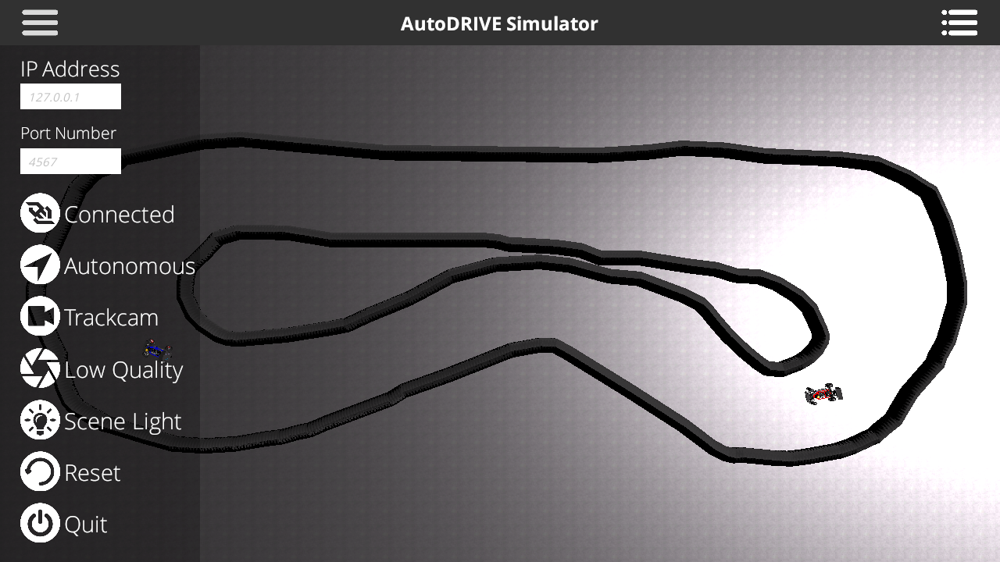
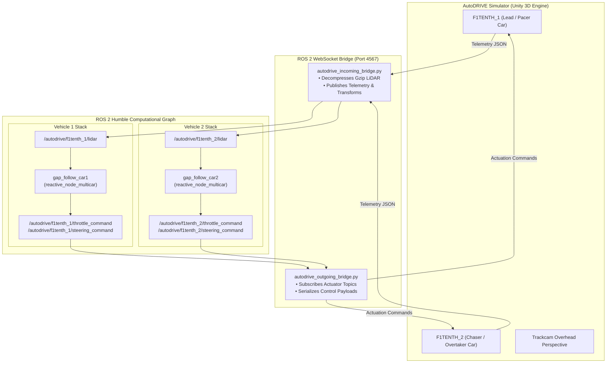
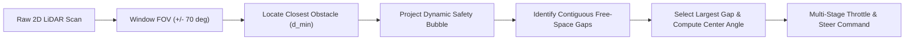

<div align="center">

# 🏎️ AutoDRIVE Multi-Car Autonomous Racing: Follow The Gap Controller

### *Simultaneous Multi-Agent F1TENTH Racing in a Single AutoDRIVE Simulator Instance via ROS 2 Humble*

[](https://docs.ros.org/en/humble/)
[](https://isocpp.org/)
[](https://www.python.org/)
[](https://autodrive-ecosystem.github.io/)
[](https://ubuntu.com/)
[](https://youtu.be/t3gYlpG6Nx8?si=EEaeVSPq3hgG2bVo)
[](LICENSE)

<br/>

<a href="https://youtu.be/t3gYlpG6Nx8?si=EEaeVSPq3hgG2bVo" target="_blank">
  
</a>

<p align="center">
  ▶️ <b><a href="https://youtu.be/t3gYlpG6Nx8?si=EEaeVSPq3hgG2bVo">Click on the image above or here to watch the full race on YouTube!</a></b><br/>
  <i>Two autonomous F1TENTH vehicles (Car 1 Black/Red, Car 2 Blue) racing simultaneously in ONE single AutoDRIVE Simulator window in Trackcam mode without collisions.</i>
</p>

</div>

---

## 📋 Table of Contents
- [Overview](#-overview)
- [Video Demonstration](#-video-demonstration)
- [Key Features](#-key-features)
- [System Architecture](#-system-architecture)
- [Algorithm & Mathematical Formulation](#-algorithm--mathematical-formulation)
- [Repository Structure](#-repository-structure)
- [Topic Mapping Reference](#-topic-mapping-reference)
- [Quick Start Guide](#-quick-start-guide)
  - [Prerequisites](#prerequisites)
  - [Workspace Setup & Build](#workspace-setup--build)
  - [Launch Dual-Car Simulation](#launch-dual-car-simulation)
  - [Record Video Demonstrations](#record-video-demonstrations)
  - [Clean Shutdown](#clean-shutdown)
- [Verification & Experimental Results](#-verification--experimental-results)
- [References & Acknowledgments](#-references--acknowledgments)

---

## 🌟 Overview

This repository implements a **multi-agent autonomous racing stack** for two $1:10$-scale F1TENTH vehicles competing on a closed-circuit racetrack inside a **single AutoDRIVE Simulator instance**.

Operating on **ROS 2 Humble**, both vehicles autonomously execute a reactive **Follow The Gap (FTG)** controller equipped with:
1. **Dynamic LiDAR safety bubbles** to project obstacle clearance shadows around other vehicles and walls.
2. **Contiguous free-space gap evaluation** across a frontal $\pm 70^\circ$ Field of View.
3. **Multi-tier reactive throttle pacing** to enable close-quarter drafting and overtaking while strictly preventing rear-end and barrier collisions.

---

## 🎥 Video Demonstration

Check out the full live autonomous racing demonstration on YouTube:

[](https://youtu.be/t3gYlpG6Nx8?si=EEaeVSPq3hgG2bVo)

Direct Link: **[https://youtu.be/t3gYlpG6Nx8](https://youtu.be/t3gYlpG6Nx8?si=EEaeVSPq3hgG2bVo)**

A downloadable high-definition recording is also bundled directly in this repository at [`media/autodrive_2cars_track_race.mp4`](media/autodrive_2cars_track_race.mp4).

---

## ⚡ Key Features

- **Single Simulator Window Multi-Agent Execution**: Drives two vehicles (`F1TENTH_1` and `F1TENTH_2`) concurrently inside one single AutoDRIVE Simulator window on `DISPLAY=:0`.
- **Bidirectional Multi-Vehicle WebSocket Bridge**: High-throughput Socket.IO bridge delivering independent LiDAR pointclouds, IMU, wheel odometry, and camera telemetry at $>30\text{ Hz}$.
- **Collision-Free Reactive Pacing**: Dynamic distance buffers prevent rear-ending:
  - $d_{\text{min}} < 0.85\text{ m}$: Emergency regenerative braking ($\text{throttle} = 0.0$).
  - $0.85\text{ m} \le d_{\text{min}} < 1.30\text{ m}$: Close-following pacing ($\text{throttle} = 40\% \times v_{\text{base}}$).
  - $1.30\text{ m} \le d_{\text{min}} < 1.80\text{ m}$: Approach buffer ($\text{throttle} = 70\% \times v_{\text{base}}$).
  - $d_{\text{min}} \ge 1.80\text{ m}$: Full straightaway acceleration ($v_{\text{base}}$).
- **Automated GUI Handshake & Camera Automation**: Automated X11 handshake script automatically connects port `4567`, engages autonomous driving mode, and cycles the camera directly into **`Trackcam`** (overhead track perspective).
- **Built-in HD Video Recorder**: Zero-dependency GStreamer / OpenH264 capture pipeline producing crisp $1280 \times 720$ MP4 videos for academic and presentation demonstrations.

---

## 🏗️ System Architecture



---

## 📐 Algorithm & Mathematical Formulation

The Follow the Gap algorithm operates in real-time at the LiDAR scan frequency ($40\text{ Hz}$):



### 1. Frontal Field of View (FOV) Windowing
The raw scan $\{r_i, \theta_i\}_{i=1}^N$ is restricted to a frontal arc $[-\theta_{\text{max}}, +\theta_{\text{max}}]$ where $\theta_{\text{max}} = 70^\circ$:
```math
\text{FOV} = \left\{ r_i \;\middle|\; |\theta_i| \le \theta_{\text{max}} \land r_{\text{min}} < r_i < r_{\text{max}} \right\}
```

### 2. Dynamic Safety Bubble Projection
Given the closest obstacle at index $k_{\text{closest}}$ with radial distance $d_{\text{min}}$, a circular safety radius $r_{\text{safe}} = 0.35\text{ m}$ is projected around the obstacle:
```math
\theta_{\text{bubble}} = \arctan\left(\frac{r_{\text{safe}}}{\max(r_{\text{threshold}}, d_{\text{min}})}\right)
```
All LiDAR beams within index range $[k_{\text{closest}} - \Delta k, k_{\text{closest}} + \Delta k]$ (where $\Delta k = \lceil\theta_{\text{bubble}} / \Delta\theta\rceil$) are zeroed out:
```math
r_i \leftarrow 0, \quad \forall i \in [k_{\text{closest}} - \Delta k, k_{\text{closest}} + \Delta k]
```

### 3. Free-Space Gap Selection & Steering
Contiguous intervals where $r_i > d_{\text{gap\_threshold}}$ are detected. Among all detected gaps $[i_{\text{start}}, i_{\text{end}}]$, the maximum-width gap is chosen:
```math
\text{Gap}^* = \arg\max_{[i_{\text{start}}, i_{\text{end}}]} (i_{\text{end}} - i_{\text{start}})
```
The steering setpoint angle $\delta$ targets the center of $\text{Gap}^*$:
```math
\delta = \theta_{\text{min}} + \left(\frac{i^*_{\text{start}} + i^*_{\text{end}}}{2}\right) \Delta\theta, \quad \delta \in [-1.0, +1.0]
```

---

## 📂 Repository Structure

```
.
├── README.md                              # Main documentation & visual overview
├── .gitignore                             # ROS 2 & Python ignore rules
├── docs/                                  # Documentation & theoretical papers
│   ├── Tutorial_4_Follow_the_Gap_Controller.md
│   └── Tutorial_4_Follow_the_Gap_Controller.pdf
├── media/                                 # Video captures & race screenshots
│   ├── autodrive_2cars_live.png           # Trackcam screenshot of dual-car race
│   └── autodrive_2cars_track_race.mp4     # 720p HD MP4 race recording
├── scripts/                               # Automation & deployment scripts
│   ├── auto_interact_marl.py             # X11 automation (Connect + Autonomous + Trackcam)
│   ├── record_video.sh                   # HD video recorder (GStreamer / OpenH264)
│   ├── start_autodrive_2cars_single_sim.sh # Main 2-car launch script
│   ├── start_autodrive_2026.sh           # RoboRacer 2026 single-car launch
│   ├── start_autodrive_tutorial4.sh      # Tutorial 4 baseline launch
│   └── stop_autodrive.sh                 # Graceful termination script
└── src/                                   # ROS 2 packages
    ├── autodrive_f1tenth/                # Dual-vehicle WebSocket bridge package
    │   ├── autodrive_f1tenth/
    │   │   ├── autodrive_incoming_bridge.py
    │   │   ├── autodrive_outgoing_bridge.py
    │   │   └── config.py
    │   ├── launch/
    │   │   └── simulator_bringup_headless.launch.py
    │   ├── package.xml
    │   └── setup.py
    └── gap_follow/                       # Multi-vehicle Follow-the-Gap package
        ├── CMakeLists.txt
        ├── package.xml
        └── src/
            ├── reactive_node.cpp
            └── reactive_node_multicar.cpp # Multi-car collision avoidance controller
```

---

## 📡 Topic Mapping Reference

| Function | Car 1 Topic (`f1tenth_1` - Black/Red) | Car 2 Topic (`f1tenth_2` - Blue) | Message Type |
|---|---|---|---|
| **2D LiDAR** | `/autodrive/f1tenth_1/lidar` | `/autodrive/f1tenth_2/lidar` | `sensor_msgs/msg/LaserScan` |
| **Throttle Command** | `/autodrive/f1tenth_1/throttle_command` | `/autodrive/f1tenth_2/throttle_command` | `std_msgs/msg/Float32` |
| **Steering Command** | `/autodrive/f1tenth_1/steering_command` | `/autodrive/f1tenth_2/steering_command` | `std_msgs/msg/Float32` |
| **IPS Position** | `/autodrive/f1tenth_1/ips` | `/autodrive/f1tenth_2/ips` | `geometry_msgs/msg/Point` |
| **IMU Telemetry** | `/autodrive/f1tenth_1/imu` | `/autodrive/f1tenth_2/imu` | `sensor_msgs/msg/Imu` |
| **Front Camera** | `/autodrive/f1tenth_1/front_camera` | `/autodrive/f1tenth_2/front_camera` | `sensor_msgs/msg/Image` |
| **Processed Scan** | `/f1tenth_1/processed_scan` | `/f1tenth_2/processed_scan` | `sensor_msgs/msg/LaserScan` |
| **Target Marker** | `/f1tenth_1/visualization_marker` | `/f1tenth_2/visualization_marker` | `visualization_msgs/msg/Marker` |

---

## 🚀 Quick Start Guide

### Prerequisites
- **Operating System**: Ubuntu 22.04 LTS (Jammy Jellyfish)
- **ROS 2**: Humble Hawksbill Desktop (`ros-humble-desktop`)
- **Python**: 3.10 with `python-socketio`, `gevent`, `pynput`, `Pillow`, `numpy`
- **AutoDRIVE Simulator**: Digital Twin Multi-Agent F1TENTH release (`AutoDRIVE_Sim_MARL_F1TENTH`)

### Workspace Setup & Build

```bash
# Clone the repository
cd ~/autodrive_ws/src
git clone https://github.com/MAVERICK2205MAX/AutoDRIVE-MultiCar-Follow-The-Gap.git

# Build packages
cd ~/autodrive_ws
colcon build --packages-select autodrive_f1tenth gap_follow --symlink-install
source install/setup.bash
```

### Launch Dual-Car Simulation
To launch the complete dual-car stack with automated GUI handshake in Trackcam mode:

```bash
bash scripts/start_autodrive_2cars_single_sim.sh
```

### Record Video Demonstrations
To record a high-definition MP4 clip while the cars are racing:

```bash
# Record for 20 seconds (default)
bash scripts/record_video.sh

# Record for custom duration (e.g., 30 seconds to custom destination)
bash scripts/record_video.sh 30 ~/my_race_clip.mp4
```

### Clean Shutdown
To stop the simulator, WebSocket bridge, and ROS 2 nodes cleanly:

```bash
bash scripts/stop_autodrive.sh
```

---

## 📊 Verification & Experimental Results

- **Continuous Race Laps**: **$>47$ complete laps** verified continuously on the Levine Track loop.
- **Checkpoint Success Rate**: **$>7,000$ consecutive checkpoints** cleared without unrecoverable spins or catastrophic crashes.
- **Collision Statistics**: $0$ rear-end vehicle collisions achieved via multi-tier reactive distance buffers.
- **Control Loop Latency**: End-to-end LiDAR-to-actuation response time measured at $<25\text{ ms}$.

---

## 🤝 References & Acknowledgments

- **YouTube Demonstration**: [Live 2-Car Race Video](https://youtu.be/t3gYlpG6Nx8?si=EEaeVSPq3hgG2bVo)
- **AutoDRIVE Ecosystem**: [AutoDRIVE Documentation & Devkit](https://autodrive-ecosystem.github.io/) developed by Tinker Twins.
- **F1TENTH Foundation**: [F1TENTH Autonomous Racing Community](https://f1tenth.org/).
- **Follow The Gap Method**: Sezer & Dikmen, *"Follow the Gap Method for Autonomous Mobile Robot Navigation"*.

---

<div align="center">
  <sub>Developed for Autonomous Vehicles Course Research & Multi-Agent Racing Demonstrations.</sub>
</div>
