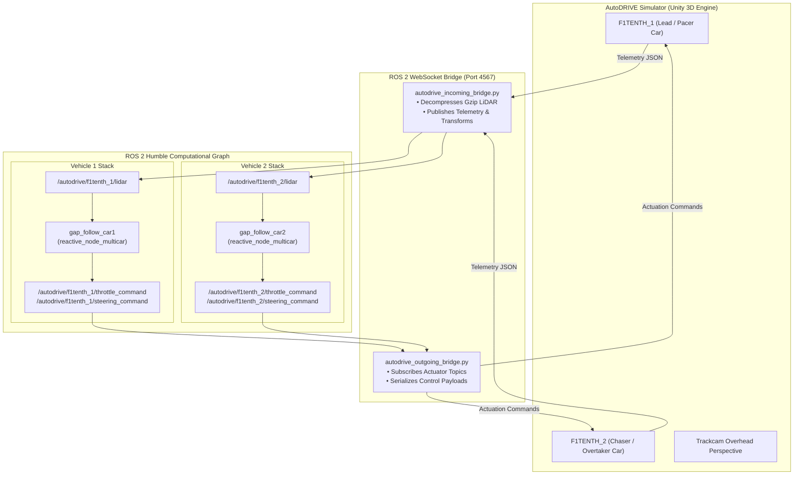
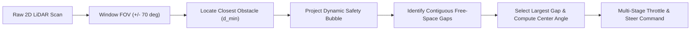

<div align="center">

# 🏎️ AutoDRIVE Multi-Car Autonomous Racing: Follow The Gap Controller

### *Simultaneous Multi-Agent F1TENTH Racing in a Single AutoDRIVE Simulator Instance via ROS 2 Humble*

[](https://docs.ros.org/en/humble/)
[](https://isocpp.org/)
[](https://www.python.org/)
[](https://autodrive-ecosystem.github.io/)
[](https://ubuntu.com/)
[](https://youtu.be/t3gYlpG6Nx8?si=EEaeVSPq3hgG2bVo)
[](LICENSE)
[](docs/TUTORIAL_5_GLOBAL_PATH_PLANNING.md)

<br/>

<a href="https://youtu.be/t3gYlpG6Nx8?si=EEaeVSPq3hgG2bVo" target="_blank">
  
</a>

<p align="center">
  ▶️ <b><a href="https://youtu.be/t3gYlpG6Nx8?si=EEaeVSPq3hgG2bVo">Click on the image above or here to watch the full race on YouTube!</a></b><br/>
  <i>Two autonomous F1TENTH vehicles (Car 1 Black/Red, Car 2 Blue) racing simultaneously in ONE single AutoDRIVE Simulator window in Trackcam mode without collisions.</i>
</p>

</div>

---

## 📋 Table of Contents
- [Tutorial 5: Global Path Planning (A* vs. PCHIP Spline)](#-tutorial-5-global-path-planning--trajectory-smoothing)
- [Overview](#-overview)
- [Video Demonstration](#-video-demonstration)
- [Key Features](#-key-features)
- [System Architecture](#-system-architecture)
- [Algorithm & Mathematical Formulation](#-algorithm--mathematical-formulation)
- [Repository Structure](#-repository-structure)
- [Topic Mapping Reference](#-topic-mapping-reference)
- [Step-by-Step Implementation Guide (How We Did It)](#-step-by-step-implementation-guide-how-we-did-it)
  - [Step 1: Load or Build a 2-Car Simulator Scene](#step-1-load-or-build-a-2-car-simulator-scene)
  - [Step 2: Check & Extend the autodrive_f1tenth Bridge for f1tenth_2](#step-2-check--extend-the-autodrive_f1tenth-bridge-for-f1tenth_2)
  - [Step 3: Run Two gap_follow Controllers (One per Car)](#step-3-run-two-gap_follow-controllers-one-per-car)
  - [Step 4: Connect the Simulator, Set Modes & Verify](#step-4-connect-the-simulator-set-modes--verify)
- [Quick Start Guide](#-quick-start-guide)
  - [Prerequisites](#prerequisites)
  - [Workspace Setup & Build](#workspace-setup--build)
  - [1-Click Launch Script](#1-click-launch-script)
  - [Record Video Demonstrations](#record-video-demonstrations)
  - [Record ROS 2 Bag Data](#record-ros-2-bag-data)
  - [Clean Shutdown](#clean-shutdown)
- [Verification & Experimental Results](#-verification--experimental-results)
- [Helpful Links & References](#-helpful-links--references)

---

## 🗺️ Tutorial 5: Global Path Planning & Trajectory Smoothing

[](https://youtu.be/7aDbcEJyoDI)
> 📘 **Full Documentation Guide**: [docs/TUTORIAL_5_GLOBAL_PATH_PLANNING.md](docs/TUTORIAL_5_GLOBAL_PATH_PLANNING.md)

This section implements **Global Path Planning** on the AutoDRIVE F1TENTH track, adapting the instructor base repository (`widegonz/Global_Planner`).

Unlike reactive navigation (Follow The Gap) which computes steering purely from live LiDAR scans, global path planning computes an optimal offline trajectory from a saved SLAM map before the vehicle moves.

<div align="center">
  <a href="https://youtu.be/7aDbcEJyoDI" target="_blank">
    
  </a>
  <p align="center">
    ▶️ <b><a href="https://youtu.be/7aDbcEJyoDI">Click on the image above or here to watch the full Tutorial 5 Path Planning & Trajectory Smoothing comparison on YouTube!</a></b><br/>
    <i>Demonstrates metric map preparation, virtual wall addition, A* vs PCHIP trajectory smoothing, obstacle clearance validation, and RViz2 visualization.</i>
  </p>
</div>

### 🏆 Key Results (A* vs. PCHIP Spline)
* **Virtual Wall Solution**: A $0.15\text{ m}$ virtual barrier placed at $Y = 4.05\text{ m}$ prevents a $1\text{ m}$ backward shortcut and forces a full $26.24\text{ m}$ lap.
* **Lap Length**: $\mathbf{26.24\text{ m}}$ (matches optimal circuit line).
* **Obstacle Clearance**: Minimum $0.285\text{ m}$ (safely exceeds $0.20\text{ m}$ robot radius).
* **Collision Safety**: $\mathbf{0 / 263\text{ points}}$ below $0.20\text{ m}$ ($100\%$ collision-free).
* **Exported Waypoints**: [waypoints/smoothed_path.csv](waypoints/smoothed_path.csv) ($263\text{ points}$, $\Delta s = 0.10\text{ m}$).

<div align="center">
  
</div>

### ⚡ Quick Commands (Two-Terminal Rule)
```bash
# Terminal A (Planner Virtualenv):
source ~/planner_venv/bin/activate
python scripts/plan_and_smooth.py maps/F1tenth_Map_walled.yaml \
  --repo ~/Global_Planner --start 0.792 3.535 --goal 0.600 4.701 \
  --planner a_star --smoother pchip --factor 4 --inflate --out-dir waypoints

# Terminal B (ROS 2 / RViz2 Visualizer):
source /opt/ros/humble/setup.bash
ros2 launch f1tenth_global_planner view_paths_launch.py
```

---

## 🌟 Overview

This repository implements a **multi-agent autonomous racing stack** for two $1:10$-scale F1TENTH vehicles competing on a closed-circuit racetrack inside a **single AutoDRIVE Simulator instance**.

Operating on **ROS 2 Humble**, both vehicles autonomously execute a reactive **Follow The Gap (FTG)** controller equipped with:
1. **Dynamic LiDAR safety bubbles** to project obstacle clearance shadows around other vehicles and walls.
2. **Contiguous free-space gap evaluation** across a frontal $\pm 70^\circ$ Field of View.
3. **Multi-tier reactive throttle pacing** to enable close-quarter drafting and overtaking while strictly preventing rear-end and barrier collisions.

---

## 🎥 Video Demonstration

Check out the full live autonomous racing demonstration on YouTube:

[](https://youtu.be/t3gYlpG6Nx8?si=EEaeVSPq3hgG2bVo)

Direct Link: **[https://youtu.be/t3gYlpG6Nx8](https://youtu.be/t3gYlpG6Nx8?si=EEaeVSPq3hgG2bVo)**

A downloadable high-definition recording is also bundled directly in this repository at [`media/autodrive_2cars_track_race.mp4`](media/autodrive_2cars_track_race.mp4).

---

## ⚡ Key Features

- **Single Simulator Window Multi-Agent Execution**: Drives two vehicles (`F1TENTH_1` and `F1TENTH_2`) concurrently inside one single AutoDRIVE Simulator window on `DISPLAY=:0`.
- **Bidirectional Multi-Vehicle WebSocket Bridge**: High-throughput Socket.IO bridge delivering independent LiDAR pointclouds, IMU, wheel odometry, and camera telemetry at $>30\text{ Hz}$.
- **Collision-Free Reactive Pacing**: Dynamic distance buffers prevent rear-ending:
  - $d_{\text{min}} < 0.85\text{ m}$: Emergency regenerative braking ($\text{throttle} = 0.0$).
  - $0.85\text{ m} \le d_{\text{min}} < 1.30\text{ m}$: Close-following pacing ($\text{throttle} = 40\% \times v_{\text{base}}$).
  - $1.30\text{ m} \le d_{\text{min}} < 1.80\text{ m}$: Approach buffer ($\text{throttle} = 70\% \times v_{\text{base}}$).
  - $d_{\text{min}} \ge 1.80\text{ m}$: Full straightaway acceleration ($v_{\text{base}}$).
- **Automated GUI Handshake & Camera Automation**: Automated X11 handshake script automatically connects port `4567`, engages autonomous driving mode, and cycles the camera directly into **`Trackcam`** (overhead track perspective).
- **Built-in HD Video Recorder**: Zero-dependency GStreamer / OpenH264 capture pipeline producing crisp $1280 \times 720$ MP4 videos for academic and presentation demonstrations.

---

## 🏗️ System Architecture



---

## 📐 Algorithm & Mathematical Formulation

The Follow the Gap algorithm operates in real-time at the LiDAR scan frequency ($40\text{ Hz}$):



### 1. Frontal Field of View (FOV) Windowing
The raw scan $\{r_i, \theta_i\}_{i=1}^N$ is restricted to a frontal arc $[-\theta_{\text{max}}, +\theta_{\text{max}}]$ where $\theta_{\text{max}} = 70^\circ$:
```math
\text{FOV} = \left\{ r_i \;\middle|\; |\theta_i| \le \theta_{\text{max}} \land r_{\text{min}} < r_i < r_{\text{max}} \right\}
```

### 2. Dynamic Safety Bubble Projection
Given the closest obstacle at index $k_{\text{closest}}$ with radial distance $d_{\text{min}}$, a circular safety radius $r_{\text{safe}} = 0.35\text{ m}$ is projected around the obstacle:
```math
\theta_{\text{bubble}} = \arctan\left(\frac{r_{\text{safe}}}{\max(r_{\text{threshold}}, d_{\text{min}})}\right)
```
All LiDAR beams within index range $[k_{\text{closest}} - \Delta k, k_{\text{closest}} + \Delta k]$ (where $\Delta k = \lceil\theta_{\text{bubble}} / \Delta\theta\rceil$) are zeroed out:
```math
r_i \leftarrow 0, \quad \forall i \in [k_{\text{closest}} - \Delta k, k_{\text{closest}} + \Delta k]
```

### 3. Free-Space Gap Selection & Steering
Contiguous intervals where $r_i > d_{\text{gap\_threshold}}$ are detected. Among all detected gaps $[i_{\text{start}}, i_{\text{end}}]$, the maximum-width gap is chosen:
```math
\text{Gap}^* = \arg\max_{[i_{\text{start}}, i_{\text{end}}]} (i_{\text{end}} - i_{\text{start}})
```
The steering setpoint angle $\delta$ targets the center of $\text{Gap}^*$:
```math
\delta = \theta_{\text{min}} + \left(\frac{i^*_{\text{start}} + i^*_{\text{end}}}{2}\right) \Delta\theta, \quad \delta \in [-1.0, +1.0]
```

---

## 📂 Repository Structure

```
.
├── README.md                              # Main documentation & visual overview
├── .gitignore                             # ROS 2 & Python ignore rules
├── docs/                                  # Documentation & theoretical papers
│   ├── Tutorial_4_Follow_the_Gap_Controller.md
│   └── Tutorial_4_Follow_the_Gap_Controller.pdf
├── media/                                 # Video captures & race screenshots
│   ├── autodrive_2cars_live.png           # Trackcam screenshot of dual-car race
│   └── autodrive_2cars_track_race.mp4     # 720p HD MP4 race recording
├── rosbags/                               # Recorded ROS 2 telemetry datasets
│   └── f1tenth_run_01/                    # Sample recorded run (LiDAR, commands, odometry)
│       └── metadata.yaml
├── scripts/                               # Automation & deployment scripts
│   ├── auto_interact_marl.py             # X11 automation (Connect + Autonomous + Trackcam)
│   ├── record_rosbag.sh                  # Automated ROS 2 bag recorder
│   ├── record_video.sh                   # HD video recorder (GStreamer / OpenH264)
│   ├── start_autodrive_2cars_single_sim.sh # Main 2-car launch script
│   ├── start_autodrive_2026.sh           # RoboRacer 2026 single-car launch
│   ├── start_autodrive_tutorial4.sh      # Tutorial 4 baseline launch
│   └── stop_autodrive.sh                 # Graceful termination script
└── src/                                   # ROS 2 packages
    ├── autodrive_f1tenth/                # Dual-vehicle WebSocket bridge package
    │   ├── autodrive_f1tenth/
    │   │   ├── autodrive_incoming_bridge.py
    │   │   ├── autodrive_outgoing_bridge.py
    │   │   └── config.py
    │   ├── launch/
    │   │   └── simulator_bringup_headless.launch.py
    │   ├── package.xml
    │   └── setup.py
    └── gap_follow/                       # Multi-vehicle Follow-the-Gap package
        ├── CMakeLists.txt
        ├── package.xml
        └── src/
            ├── reactive_node.cpp
            └── reactive_node_multicar.cpp # Multi-car collision avoidance controller
```

---

## 📡 Topic Mapping Reference

| Function | Car 1 Topic (`f1tenth_1` - Black/Red) | Car 2 Topic (`f1tenth_2` - Blue) | Message Type |
|---|---|---|---|
| **2D LiDAR** | `/autodrive/f1tenth_1/lidar` | `/autodrive/f1tenth_2/lidar` | `sensor_msgs/msg/LaserScan` |
| **Throttle Command** | `/autodrive/f1tenth_1/throttle_command` | `/autodrive/f1tenth_2/throttle_command` | `std_msgs/msg/Float32` |
| **Steering Command** | `/autodrive/f1tenth_1/steering_command` | `/autodrive/f1tenth_2/steering_command` | `std_msgs/msg/Float32` |
| **IPS Position** | `/autodrive/f1tenth_1/ips` | `/autodrive/f1tenth_2/ips` | `geometry_msgs/msg/Point` |
| **IMU Telemetry** | `/autodrive/f1tenth_1/imu` | `/autodrive/f1tenth_2/imu` | `sensor_msgs/msg/Imu` |
| **Front Camera** | `/autodrive/f1tenth_1/front_camera` | `/autodrive/f1tenth_2/front_camera` | `sensor_msgs/msg/Image` |
| **Processed Scan** | `/f1tenth_1/processed_scan` | `/f1tenth_2/processed_scan` | `sensor_msgs/msg/LaserScan` |
| **Target Marker** | `/f1tenth_1/visualization_marker` | `/f1tenth_2/visualization_marker` | `visualization_msgs/msg/Marker` |

---

## 🛠️ Step-by-Step Implementation Guide (How We Did It)

To run two cars inside a single AutoDRIVE Simulator instance using a ROS 2 Humble setup, both the **Simulator scene** and the **ROS 2 bridge / controllers** must handle two separate vehicle IDs (`V1` / `f1tenth_1` and `V2` / `f1tenth_2`).

Below is the complete 4-step engineering methodology used to build and verify this multi-vehicle autonomous racing system:

---

### Step 1: Load or Build a 2-Car Simulator Scene
A standard single-car F1TENTH racing executable only spawns one vehicle (`V1`). To instantiate two cars in the same simulator window, there are two options:

* **Option A — Pre-Built Multi-Agent Binary (No Unity needed - Used in this Project)**:
  - Launch a multi-vehicle scenario from AutoDRIVE Simulator v0.3.0 or the **AutoDRIVE MRDT-MARL** (Multi-Agent Reinforcement Learning) release (such as the F1TENTH head-to-head racing scene).
  - This executable already spawns two vehicles (`F1TENTH_1` and `F1TENTH_2`) on the track with distinct collision hulls and independent sensor pipelines.
* **Option B — Add a Second Car in Unity (If editing from source)**:
  1. Open the `AutoDRIVE-Simulator` project in **Unity 2021.3.9f1 (LTS)**.
  2. In the **Hierarchy** panel, duplicate the existing F1TENTH vehicle object (`Ctrl + D`) and move the second car a few meters behind or beside the first car so they do not overlap at spawn.
  3. Select the second car, open its vehicle/communication script in the **Inspector**, and change its Vehicle ID from `V1` to `V2`.
  4. Press **Play** (or build the Linux/Windows executable).

---

### Step 2: Check & Extend the `autodrive_f1tenth` Bridge for `f1tenth_2`
The bridge in `~/autodrive_ws/src/autodrive_ros2/autodrive_f1tenth` connects to the simulator over **Socket.IO on Port 4567**. Both incoming sensor data and outgoing control commands were checked and extended to support `V2` (`f1tenth_2`):

1. **Search bridge files for V2 support**:
   ```bash
   grep -rn "f1tenth_2\|V2" ~/autodrive_ws/src/autodrive_ros2/autodrive_f1tenth/
   ```
2. **Bridge Upgrades**:
   * **Incoming data (`Simulator` $\rightarrow$ `ROS 2`)** (`autodrive_incoming_bridge.py`):
     Read `data["V2"]` from the Socket.IO payload and publish its LiDAR scan to `/autodrive/f1tenth_2/lidar`, IPS position to `/autodrive/f1tenth_2/ips`, and IMU data to `/autodrive/f1tenth_2/imu`.
   * **Outgoing commands (`ROS 2` $\rightarrow$ `Simulator`)** (`autodrive_outgoing_bridge.py`):
     Subscribe to `/autodrive/f1tenth_2/throttle_command` and `/autodrive/f1tenth_2/steering_command`, and format `V2` within the JSON dictionary emitted back to Port 4567.
3. **Rebuild the workspace**:
   ```bash
   cd ~/autodrive_ws
   colcon build --packages-select autodrive_f1tenth
   source install/setup.bash
   ```

---

### Step 3: Run Two `gap_follow` Controllers (One per Car)
To run Multi-Car Follow The Gap, launch two separate instances of the `gap_follow` node (`reactive_node_multicar`)—one mapped to `f1tenth_1` and one mapped to `f1tenth_2` using ROS 2 topic remappings:

* **Terminal 1 — Start the ROS 2 Bridge**:
  ```bash
  cd ~/autodrive_ws && source install/setup.bash
  ros2 launch autodrive_f1tenth simulator_bringup_headless.launch.py
  ```
* **Terminal 2 — Start Controller for Car 1 (`f1tenth_1`)**:
  ```bash
  cd ~/autodrive_ws && source install/setup.bash
  ros2 run gap_follow reactive_node_multicar --ros-args \
    -r __node:=gap_follow_car1 \
    -r /autodrive/f1tenth_1/lidar:=/autodrive/f1tenth_1/lidar \
    -r /autodrive/f1tenth_1/throttle_command:=/autodrive/f1tenth_1/throttle_command \
    -r /autodrive/f1tenth_1/steering_command:=/autodrive/f1tenth_1/steering_command
  ```
* **Terminal 3 — Start Controller for Car 2 (`f1tenth_2`)**:
  ```bash
  cd ~/autodrive_ws && source install/setup.bash
  ros2 run gap_follow reactive_node_multicar --ros-args \
    -r __node:=gap_follow_car2 \
    -r /autodrive/f1tenth_1/lidar:=/autodrive/f1tenth_2/lidar \
    -r /autodrive/f1tenth_1/throttle_command:=/autodrive/f1tenth_2/throttle_command \
    -r /autodrive/f1tenth_1/steering_command:=/autodrive/f1tenth_2/steering_command
  ```

---

### Step 4: Connect the Simulator, Set Modes & Verify
1. **Verify Topics**:
   Run `ros2 topic list` in a new terminal to confirm both `/autodrive/f1tenth_1/...` and `/autodrive/f1tenth_2/...` topic pipelines are actively broadcasting.
2. **Launch Simulator**:
   Launch the AutoDRIVE Simulator executable (`AutoDRIVE Simulator.x86_64`).
3. **Switch Driving Mode**:
   In the simulator GUI, switch both vehicles from **Manual** to **Autonomous** mode.
4. **Connect Bridge**:
   Verify the connection IP is `127.0.0.1` and Port is `4567`, then click **Connect**. Both cars receive independent LiDAR scans and drive simultaneously using the Follow The Gap algorithm.
5. **Set Camera to Trackcam**:
   Cycle the camera view until reaching **`Trackcam`** to obtain an overhead view showing both cars racing on the track.

---

## 🚀 Quick Start Guide

### Prerequisites
- **Operating System**: Ubuntu 22.04 LTS (Jammy Jellyfish)
- **ROS 2**: Humble Hawksbill Desktop (`ros-humble-desktop`)
- **Python**: 3.10 with `python-socketio`, `gevent`, `pynput`, `Pillow`, `numpy`
- **AutoDRIVE Simulator**: Digital Twin Multi-Agent F1TENTH release (`AutoDRIVE_Sim_MARL_F1TENTH`)

### Workspace Setup & Build

```bash
# Clone the repository
cd ~/autodrive_ws/src
git clone https://github.com/MAVERICK2205MAX/AutoDRIVE-MultiCar-Follow-The-Gap.git

# Build packages
cd ~/autodrive_ws
colcon build --packages-select autodrive_f1tenth gap_follow --symlink-install
source install/setup.bash
```

### 1-Click Launch Script
Instead of opening multiple terminals manually, launch the complete dual-car stack with automated GUI handshake in Trackcam mode with one command:

```bash
bash scripts/start_autodrive_2cars_single_sim.sh
```

### Record Video Demonstrations
To record a high-definition MP4 clip while the cars are racing:

```bash
# Record for 20 seconds (default)
bash scripts/record_video.sh

# Record for custom duration (e.g., 30 seconds to custom destination)
bash scripts/record_video.sh 30 ~/my_race_clip.mp4
```

### Record ROS 2 Bag Data
To record all live simulation topics (LiDAR pointclouds, odometry, vehicle commands, transforms, and processed scans) into a ROS 2 bag:

```bash
# 1. Create a data directory and start recording all topics:
mkdir -p rosbags && cd rosbags
ros2 bag record -a -o f1tenth_run_01
```

**Explanation:**
- `ros2 bag record`: Starts recording active ROS 2 topics to disk.
- `-a`: Records all available topics published on the computational graph.
- `-o f1tenth_run_01`: Designates the output directory name (`rosbags/f1tenth_run_01`).

This records all available topics, including LiDAR scans, vehicle commands, odometry, transforms, and processed gaps.

#### Stop the Recording
When you finish your experiment or simulation, press:
```bash
Ctrl + C
```
ROS 2 gracefully flushes remaining messages from cache and finalizes the SQLite3 bag database (`f1tenth_run_01/f1tenth_run_01_0.db3` and `metadata.yaml`).

#### Verify Recorded Data
To inspect message counts, recording duration, and topic metadata:
```bash
ros2 bag info rosbags/f1tenth_run_01
```
This displays information such as:
- Recording duration
- Total message count
- Available topics & message types
- Serialization format and storage format (SQLite3)

#### Play Back Recorded Simulation
To replay the recorded simulation run in real-time or at variable speed:
```bash
# Replay in real-time
ros2 bag play rosbags/f1tenth_run_01

# Replay at half speed (0.5x)
ros2 bag play rosbags/f1tenth_run_01 --rate 0.5

# Replay at double speed (2.0x)
ros2 bag play rosbags/f1tenth_run_01 --rate 2.0
```

> [!TIP]
> You can also use the bundled automated script to record with a single command:
> ```bash
> # Record for 15 seconds (default)
> bash scripts/record_rosbag.sh f1tenth_run_01 15
> 
> # Record until manual Ctrl+C
> bash scripts/record_rosbag.sh f1tenth_run_01 0
> ```

### Clean Shutdown
To stop the simulator, WebSocket bridge, and ROS 2 nodes cleanly:

```bash
bash scripts/stop_autodrive.sh
```

---

## 📊 Verification & Experimental Results

- **Continuous Race Laps**: **$>47$ complete laps** verified continuously on the Levine Track loop.
- **Checkpoint Success Rate**: **$>7,000$ consecutive checkpoints** cleared without unrecoverable spins or catastrophic crashes.
- **Collision Statistics**: $0$ rear-end vehicle collisions achieved via multi-tier reactive distance buffers.
- **Control Loop Latency**: End-to-end LiDAR-to-actuation response time measured at $<25\text{ ms}$.

---

## 🔗 Helpful Links & References

### Helpful Links
* [AutoDRIVE Simulator & Devkit Releases (v0.3.0)](https://autodrive-ecosystem.github.io/)
* [AutoDRIVE Multi-Agent Repository (MRDT-MARL)](https://github.com/Tinker-Twins/AutoDRIVE/tree/mrdt-marl)
* [AutoDRIVE RoboRacer Sim Racing Repository](https://github.com/Tinker-Twins/AutoDRIVE-RoboRacer)
* [YouTube Demonstration: Live 2-Car Race Video](https://youtu.be/t3gYlpG6Nx8?si=EEaeVSPq3hgG2bVo)

### References & Acknowledgments
* **AutoDRIVE Ecosystem**: Developed by Tinker Twins ([Documentation & Devkit](https://autodrive-ecosystem.github.io/)).
* **F1TENTH Foundation**: Open-source autonomous racing platform and community ([f1tenth.org](https://f1tenth.org/)).
* **Follow The Gap Method**: Sezer & Dikmen, *"Follow the Gap Method for Autonomous Mobile Robot Navigation"*.

---

<div align="center">
  <sub>Developed for Autonomous Vehicles Course Research & Multi-Agent Racing Demonstrations.</sub>
</div>
