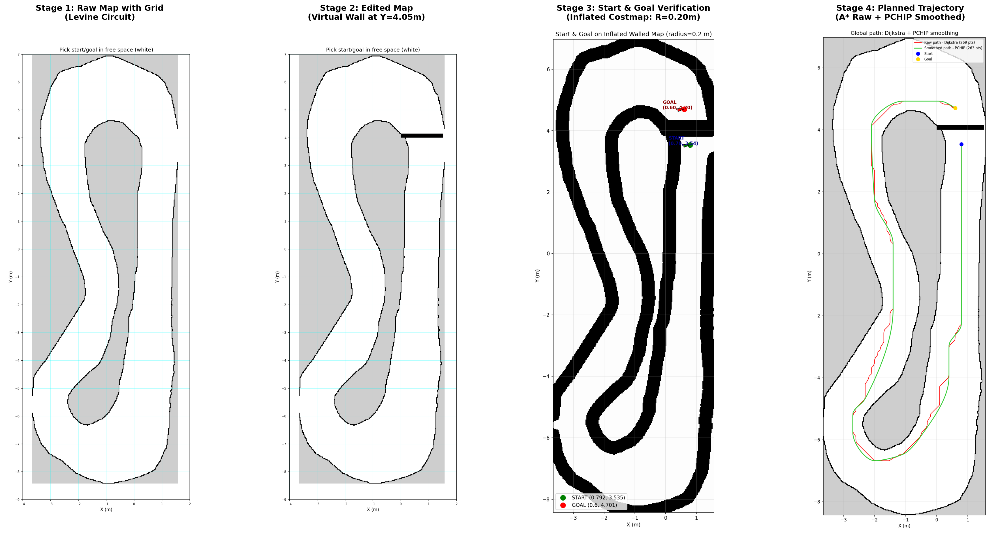
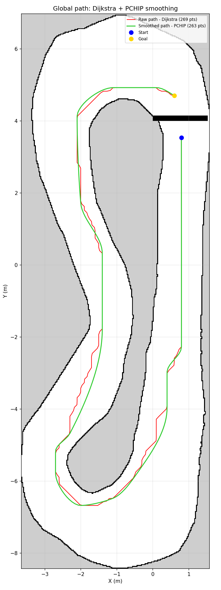

# 🗺️ Tutorial 5: F1TENTH Global Path Planning in AutoDRIVE

[](https://docs.ros.org/en/humble/)
[](https://www.python.org/)
[](https://autodrive-ecosystem.github.io/)
[](https://github.com/widegonz/Global_Planner)
[](https://scipy.org/)
[](https://youtu.be/7aDbcEJyoDI)

---

## 📌 Overview
This repository contains the complete implementation of **Tutorial 5: F1TENTH Global Path Planning** in the AutoDRIVE Simulator ecosystem.

Unlike reactive controllers (such as Follow The Gap) which react purely to live LiDAR scans, global path planning computes an optimal, collision-free route from a start coordinate to a goal coordinate before the vehicle moves.

<div align="center">
  <a href="https://youtu.be/7aDbcEJyoDI" target="_blank">
    
  </a>
  <p align="center">
    ▶️ <b><a href="https://youtu.be/7aDbcEJyoDI">Click on the image above or here to watch the full Tutorial 5 Path Planning comparison on YouTube!</a></b>
  </p>
</div>

---

## 📐 Why a Virtual Wall is Required
In a closed-loop race track, the **Start Line** and the **Finish Line** are adjacent in the exact same physical corridor, approximately $1.2\text{ m}$ apart.

Without intervention, any uninformed shortest-path algorithm (A*, Dijkstra) will take a trivial $1.2\text{ m}$ backward step instead of planning the full $26.24\text{ m}$ lap. 

By drawing a **Virtual Wall** across the track at $Y = 4.05\text{ m}$ ($X \in [0.0, 1.5]\text{ m}$):
1. The backward corridor is closed inside the planner's grid representation.
2. The search algorithm is forced to explore the entire circuit around the track.
3. The virtual wall exists **only in the planner's map image**; the real AutoDRIVE Simulator physics remain untouched.

---

## 📊 Quantitative Benchmark & Metrics

| Metric | Raw Path (A* Search) | Smoothed Path (PCHIP Spline) | Improvement / Status |
| :--- | :--- | :--- | :--- |
| **Grid Resolution** | $52 \times 154$ cells ($0.100\text{ m/cell}$) | Continuous Spline Function | High Fidelity |
| **Lap Trajectory Length** | $26.49\text{ m}$ | $\mathbf{26.24\text{ m}}$ | Optimal Shortest Lap |
| **Waypoint Count** | $269\text{ waypoints}$ | $\mathbf{263\text{ waypoints}}$ | Uniform $0.10\text{ m}$ spacing |
| **Min. Obstacle Clearance** | $0.283\text{ m}$ | $\mathbf{0.285\text{ m}}$ | Safely exceeds $0.20\text{ m}$ radius |
| **Safety Violations ($< 0.20\text{m}$)**| $\mathbf{0 / 269}$ | $\mathbf{0 / 263}$ | $\mathbf{100\% \text{ Collision Free}}$ |
| **Curvature & Steering** | Sharp $45^\circ / 90^\circ$ kinks | $C^1$ Continuous Curve | Smooth Steering Profiles |

<div align="center">
  
</div>

---

## ⚡ Quick Start: Two-Terminal Rule

### Terminal A (Offline Planning — Python Virtualenv)
```bash
source ~/planner_venv/bin/activate
cd ~/autodrive_ws/src/f1tenth-global-planner-autodrive

# 1. Visualize Map Bounds
python scripts/visualize_map.py ~/autodrive_ws/maps/F1tenth_Map.yaml -o ~/autodrive_ws/maps/map_with_grid.png

# 2. Add Virtual Wall
python scripts/add_virtual_wall.py ~/autodrive_ws/maps/F1tenth_Map.yaml --p1 0.0 4.05 --p2 1.5 4.05 --thickness 0.15

# 3. Plan & Smooth Trajectory
python scripts/plan_and_smooth.py \
  ~/autodrive_ws/maps/F1tenth_Map_walled.yaml \
  --repo ~/Global_Planner \
  --start 0.792 3.535 --goal 0.600 4.701 \
  --planner a_star \
  --smoother pchip \
  --factor 4 --inflate \
  --robot-radius 0.20 \
  --out-dir ~/autodrive_ws/waypoints

# 4. Generate 2D Comparison Plot
python scripts/plot_waypoints.py \
  ~/autodrive_ws/maps/F1tenth_Map_walled.yaml \
  ~/autodrive_ws/waypoints/raw_path.csv \
  ~/autodrive_ws/waypoints/smoothed_path.csv \
  -o ~/autodrive_ws/waypoints/trajectory_overlay.png
```

---

### Terminal B (ROS 2 & RViz2 Multi-Path Visualizer)
```bash
# Ensure planner_venv is NOT active
source /opt/ros/humble/setup.bash
cd ~/autodrive_ws
colcon build --packages-select f1tenth_global_planner
source ~/autodrive_ws/install/setup.bash

# Launch Map Server + Path Viewer + Pre-configured RViz2
ros2 launch f1tenth_global_planner view_paths_launch.py \
  map_yaml:=$HOME/autodrive_ws/maps/F1tenth_Map.yaml \
  waypoints_dir:=$HOME/autodrive_ws/waypoints
```

In RViz2:
- **Red Path**: Raw A* Grid Path
- **Green Path**: Smoothed PCHIP Spline Trajectory
- **Map**: Unwalled SLAM map served via `nav2_map_server`

---

## 📁 Repository Structure
```text
├── docs/
│   └── TUTORIAL_5_GLOBAL_PATH_PLANNING.md
├── maps/
│   ├── F1tenth_Map.yaml / .pgm         # Original SLAM map
│   ├── F1tenth_Map_walled.yaml / .pgm  # Edited map with Virtual Wall
│   └── map_with_grid.png               # Metric coordinate grid
├── media/
│   ├── path_planning_live_walkthrough.png
│   ├── trajectory_overlay.png
│   └── autodrive_semiblocks_walkthrough.png
├── scripts/
│   ├── add_virtual_wall.py
│   ├── plan_and_smooth.py
│   ├── plot_waypoints.py
│   ├── visualize_map.py
│   ├── generate_comparison_video.py
│   └── convert_webm_to_mp4.py
├── src/
│   └── f1tenth_global_planner/          # ROS 2 viewer & smoother package
└── waypoints/
    ├── raw_path.csv                     # A* raw coordinates
    └── smoothed_path.csv                # Resampled PCHIP waypoints (x, y, yaw)
```
